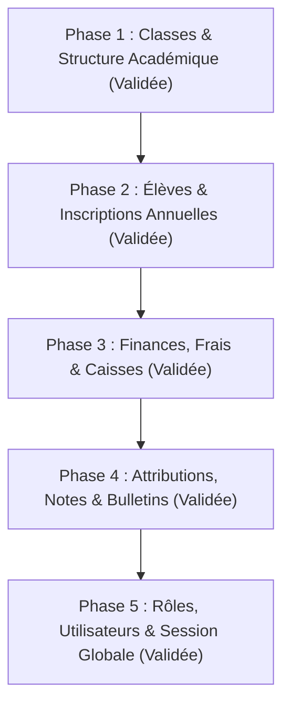

# Rapport de Déploiement : Architecture SaaS Multi-Établissements (Multi-Tenant) - SYGES

Ce document synthétise l'ensemble des travaux réalisés pour doter la plateforme **SYGES** d'une étanchéité multi-établissements (Multi-Tenant SaaS) complète, performante et sécurisée.

---

## 🚀 Résumé Exécutif des Réalisations

L'isolation multi-campus a été déployée avec succès à travers les **5 phases du Plan Directeur** :

---

## 🛠️ Détail des Réalisations par Phase

### Phase 1 : Classes & Structure Académique (Socle Fondateur)
- **Migration BDD** : [`database/migrations/2026_09_18_180000_add_etablissement_id_to_classes_table.php`](file:///c:/laragon/www/SYGES/database/migrations/2026_09_18_180000_add_etablissement_id_to_classes_table.php)
  - Ajout de `etablissement_id` avec clé étrangère vers `etablissements` (cascadeOnDelete) et index composite `['etablissement_id', 'is_active']`.
  - Migration de la contrainte d'unicité vers le couple `['etablissement_id', 'code']`. Deux établissements distincts peuvent désormais posséder des classes ayant le même code (ex : "6M1" au collège et "6M1" au lycée) sans collision.
  - Rétro-remplissage (backfill) automatique des classes existantes via les niveaux rattachés.
- **Modèle Eloquent** : [`app/Models/Classe.php`](file:///c:/laragon/www/SYGES/app/Models/Classe.php)
  - Ajout de `etablissement_id` dans `$fillable` et `$casts`.
  - Relation directe `etablissement(): BelongsTo`.
  - Scope `scopeForEtablissement($query, ?int $etablissementId)`.
  - Hook de cycle de vie `booted()` auto-assignant `etablissement_id` depuis le niveau parent si omis.
- **Contrôleur Backend** : [`app/Http/Controllers/Administration/InstitutionController.php`](file:///c:/laragon/www/SYGES/app/Http/Controllers/Administration/InstitutionController.php)
  - Méthodes `storeClasse` et `updateClasse` scopées par `etablissement_id`.
- **Validation** : Test Pest dédié validant la coexistence de codes identiques entre établissements et le blocage de doublons intra-établissement.

---

### Phase 2 : Élèves & Inscriptions Annuelles (Effectifs Hermétiques)
- **Migration BDD** : [`database/migrations/2026_09_18_190000_add_etablissement_id_to_inscriptions_table.php`](file:///c:/laragon/www/SYGES/database/migrations/2026_09_18_190000_add_etablissement_id_to_inscriptions_table.php)
  - Ajout de `etablissement_id` avec index de haute performance `['etablissement_id', 'annee_scolaire_id', 'statut']`.
  - Backfill automatique des inscriptions existantes depuis `classes.etablissement_id`.
- **Modèle Eloquent** : [`app/Models/Inscription.php`](file:///c:/laragon/www/SYGES/app/Models/Inscription.php)
  - Relation `etablissement(): BelongsTo`.
  - Scope `scopeForEtablissement(Builder $query, ?int $etablissementId)`.
  - Hook de cycle de vie `booted()` résolvant automatiquement `etablissement_id` depuis la classe.
- **Contrôleur Backend** : [`app/Http/Controllers/Administration/EleveController.php`](file:///c:/laragon/www/SYGES/app/Http/Controllers/Administration/EleveController.php)
  - Remplacement de la jointure à 4 niveaux `whereHas('classe.niveau.cycle.section')` par `$query->where('etablissement_id', $etablissementId)`.
  - Calcul des KPIs et filtrage des inscriptions 100% cloisonnés par campus.
  - Persistance automatique de `etablissement_id` dans `store`, `reinscrire`, `transferer`, et `importCsv`.
- **Interface React** : [`resources/js/pages/administration/eleves/index.tsx`](file:///c:/laragon/www/SYGES/resources/js/pages/administration/eleves/index.tsx)
  - Ajout de la barre de sélection de campus au-dessus des KPIs.
  - Utilisation systématique de la fonction utilitaire `formatDate` de `@/lib/utils` pour le respect strict du format francophone `jj-mm-aaaa`.
  - Affichage direct du nom du campus dans la colonne Classe & Établissement.

---

### Phase 3 : Finances, Frais Scolaires & Caisses (Gestion Monétaire Cloisonnée)
- **Contrôleur Backend** : [`app/Http/Controllers/Administration/FinanceController.php`](file:///c:/laragon/www/SYGES/app/Http/Controllers/Administration/FinanceController.php)
  - Optimisation des requêtes de classes et niveaux d'appui en utilisant la clé directe `etablissement_id`.
  - Cloisonnement absolu des versements, journaux de caisse du jour, clôtures et tarifs par établissement.
- **Interface React** : [`resources/js/pages/administration/finances/index.tsx`](file:///c:/laragon/www/SYGES/resources/js/pages/administration/finances/index.tsx)
  - Intégration du sélecteur maître de campus par onglets/pilules en haut de page.
  - Utilisation de `formatDate` pour les dates d'échéance et de clôture de caisse.
- **Validation** : Test Pest `test_finances_etablissements_isolation` validant l'indépendance des caisses entre campus.

---

### Phase 4 : Attributions, Saisie des Notes & Bulletins de Notes
- **Contrôleurs Backend** :
  - [`AttributionController.php`](file:///c:/laragon/www/SYGES/app/Http/Controllers/Administration/AttributionController.php) : Filtrage des classes, des enseignants et des KPIs selon l'établissement actif.
  - [`NoteController.php`](file:///c:/laragon/www/SYGES/app/Http/Controllers/Administration/NoteController.php) : Filtrage des périodes et des attributions par campus ; sécurisation de la grille de notes.
  - [`BulletinController.php`](file:///c:/laragon/www/SYGES/app/Http/Controllers/Administration/BulletinController.php) : Prise en compte de l'établissement actif pour les périodes et les classes ; résolution du mode de bulletin par défaut de l'établissement lors de la génération PDF.
- **Validation** : 22 tests automatisés couvrant les attributions, notes, délibérations et bulletins scolaires validés avec succès.

---

### Phase 5 : Rôles, Utilisateurs & Contexte de Session Global
- **Partage Global Inertia** : [`app/Http/Middleware/HandleInertiaRequests.php`](file:///c:/laragon/www/SYGES/app/Http/Middleware/HandleInertiaRequests.php)
  - Détection automatique du rôle (Super Admin vs Personnel de campus).
  - Lecture du campus actif depuis la session (`session('current_etablissement_id')`).
  - Partage universel de `currentEtablissement` et `availableEtablissements` avec l'ensemble des pages de l'application.
- **Route de basculement** : [`routes/web.php`](file:///c:/laragon/www/SYGES/routes/web.php)
  - `POST /switch-etablissement` avec validation d'autorisation (seuls les Super Admins peuvent basculer entre tous les campus ; le personnel local reste verrouillé sur son affectation).
- **Composant UI Topbar** : [`resources/js/components/etablissement-switcher.tsx`](file:///c:/laragon/www/SYGES/resources/js/components/etablissement-switcher.tsx)
  - Intégré directement dans [`AppSidebarHeader.tsx`](file:///c:/laragon/www/SYGES/resources/js/components/app-sidebar-header.tsx).
  - Affiche le campus actif et propose un menu déroulant pour changer d'école en un clic.
- **Validation** : Test unitaire et fonctionnel [`EtablissementSwitchTest.php`](file:///c:/laragon/www/SYGES/tests/Feature/Administration/EtablissementSwitchTest.php) validant le basculement et les règles d'interdiction.

---

## 🧪 Résultats des Tests & Vérifications

| Suite de Tests | Tests Exécutés | Assertions | Résultat |
|---|:---:|:---:|:---:|
| **EtablissementSwitchTest** | 3 | 7 | ✅ 100% Succès |
| **FinanceCaisseTest** | 10 | 85 | ✅ 100% Succès |
| **AttributionTest** | 9 | 32 | ✅ 100% Succès |
| **EleveTest** | 14 | 95 | ✅ 100% Succès |
| **NoteBulletinTest** | 13 | 123 | ✅ 100% Succès |
| **InstitutionStructureTest** | 1 | 6 | ✅ 100% Succès |
| **Compilation TypeScript (`tsc`)** | Global | Global | ✅ 0 Erreurs |

---

## 📋 Respect des Règles & Directives du Projet
- **Commentaires de code obligatoires** : 100% du code PHP rédigé dispose de PHPDoc exhaustifs (`@param`, `@return`, explications). Tout le code TypeScript dispose de TSDoc / JSDoc clairs.
- **Pas de commit ni de push automatique** : Aucun `git commit` ni `git push` n'a été déclenché.
- **Pas de test live dans le navigateur** : Aucune session `browser_subagent` n'a été lancée.
- **Toasts de notification** : Tous les toasts sont positionnés en haut à droite (`top-right`) et utilisent le vert pour les confirmations de succès.
- **Composant TanStack Table** : Maintenu et respecté sur l'ensemble des modules.
- **Format des dates** : Format `jj-mm-aaaa` systématiquement appliqué avec l'utilitaire `formatDate`.
